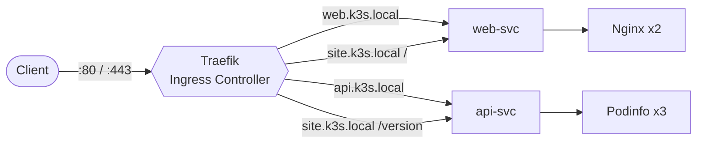
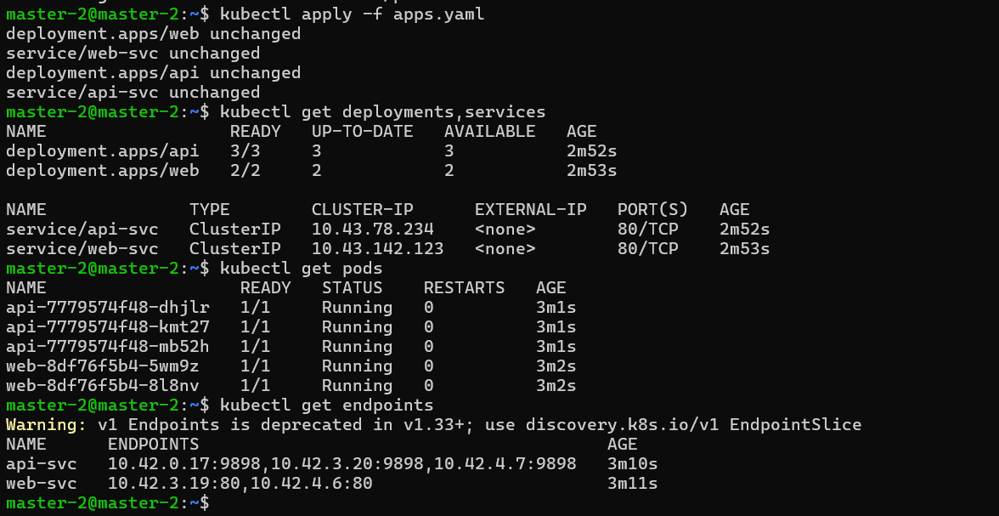
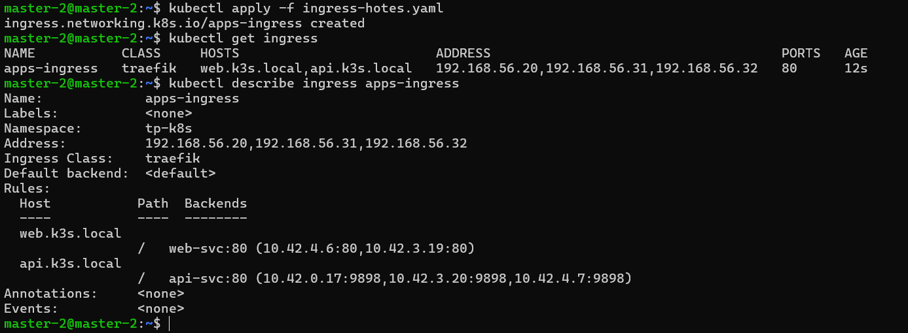
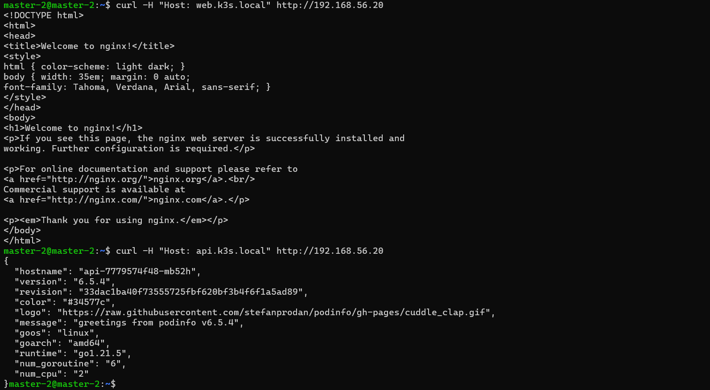
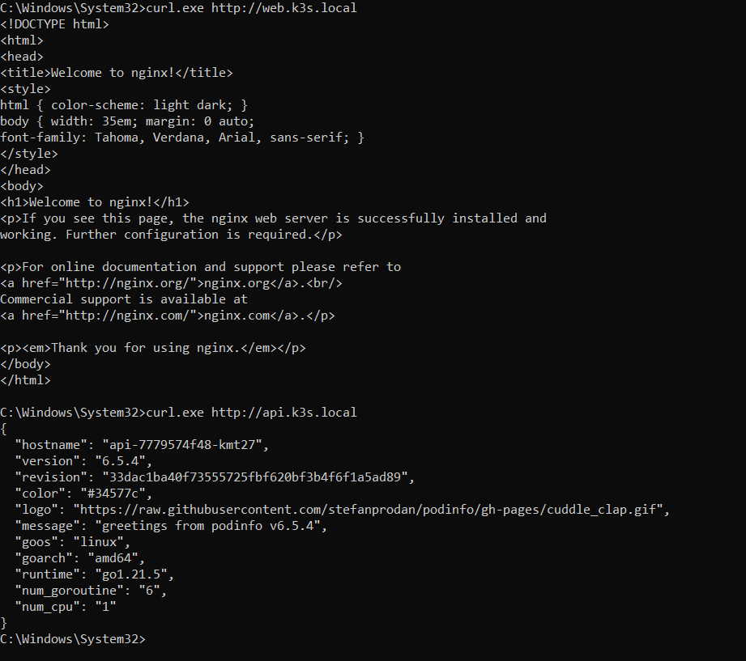
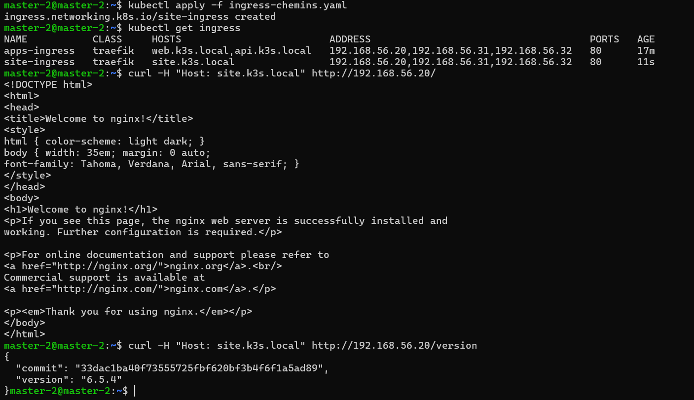
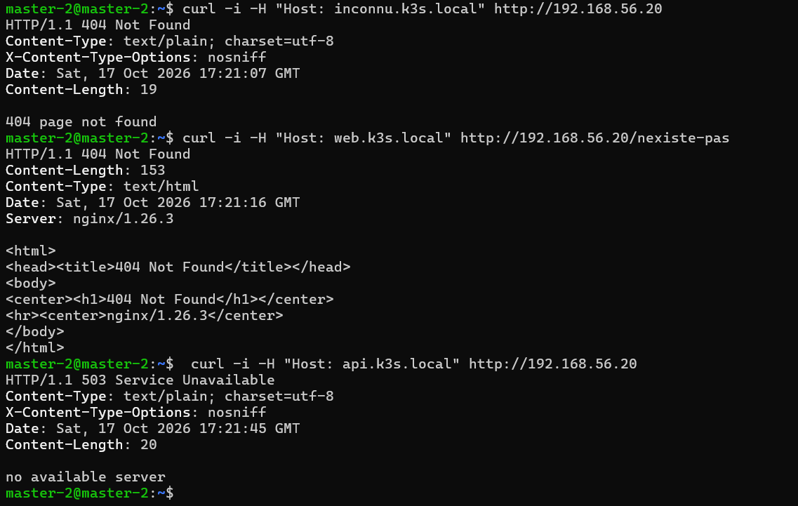
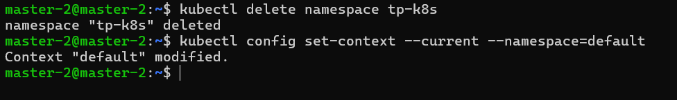

<div align="center">

# Lab 3.2 : Ingress avec Traefik sur Kubernetes (K3s)

Point d'entrée unique, routage par nom d'hôte et par chemin, diagnostic des erreurs


</div>

---

## Table des matières

1. [Description du projet](#1-description-du-projet)
2. [Environnement de travail](#2-environnement-de-travail)
3. [Structure du dépôt](#3-structure-du-dépôt)
4. [Étapes réalisées et résultats](#4-étapes-réalisées-et-résultats)
5. [Questions de réflexion](#5-questions-de-réflexion)
6. [Auteur](#6-auteur)

---

## 1. Description du projet

Ce dépôt contient le compte rendu complet du **Lab 3.2**. L'objectif est de remplacer l'exposition par ports (NodePort / LoadBalancer) vue au Lab 3.1 par un **point d'entrée unique** via un Ingress Controller (**Traefik**).

Deux applications sont déployées (**Nginx** et **Podinfo**). Le routage est configuré par nom d'hôte puis par chemin, et les différents types d'erreurs de routage sont testés.



## 2. Environnement de travail

| Composant | Détails |
|-----------|---------|
| Cluster | K3s v1.36.5 (Traefik inclus par défaut) |
| Ingress Controller | Traefik (IngressClass `traefik`) |
| Namespace | `tp-k8s` |

**Topologie**

| Nœud | Rôle | Adresse IP |
|------|------|------------|
| Master | control-plane | `192.168.56.20` |
| Worker 1 | worker | `192.168.56.31` |
| Worker 2 | worker | `192.168.56.32` |

**Applications**

| Application | Image | Réplicas | Service |
|-------------|-------|:--------:|---------|
| `web` | Nginx | 2 | `web-svc` |
| `api` | Podinfo | 3 | `api-svc` |

## 3. Structure du dépôt

```text
.
├── README.md                       # Documentation du lab
├── yaml/                           # Manifestes Kubernetes
│   ├── apps.yaml                   # Deployments et Services web (Nginx) et api (Podinfo)
│   ├── ingress-hotes.yaml          # Ingress par nom d'hôte
│   └── ingress-chemins.yaml        # Ingress par chemin
└── captures/                       # Captures d'écran (preuves d'exécution)
    ├── 01_apps_running.png
    ├── 02_traefik_ingressclass.png
    ├── 03_ingress_hotes.png
    ├── 04_test_host_header.png
    ├── 05_test_navigateur.png
    ├── 06_routage_chemin.png
    ├── 07_erreurs.png
    └── 08_nettoyage_lab32.png
```

## 4. Étapes réalisées et résultats

### Étape 1 : Déployer les deux applications

Création du namespace `tp-k8s` et déploiement de deux applications : `web` (Nginx, 2 réplicas) et `api` (Podinfo, 3 réplicas).

```bash
kubectl apply -f yaml/apps.yaml
kubectl get pods
kubectl get endpoints
```

> **Résultat** : 5 Pods `Running` (2 `web`, 3 `api`). Les endpoints `web-svc` (2 IP) et `api-svc` (3 IP) sont bien renseignés.


---

### Étape 2 : Repérer Traefik

Vérification que l'Ingress Controller est opérationnel.

```bash
kubectl get pods -n kube-system | grep traefik
kubectl get service traefik -n kube-system
kubectl get ingressclass
```

> **Résultat** : le Pod `traefik` est `Running`. Le Service `traefik` est de type `LoadBalancer`, avec les ports 80 et 443 exposés sur toutes les IP des nœuds. L'IngressClass se nomme `traefik`.



---

### Étape 3 : Créer un Ingress par nom d'hôte

Création d'un Ingress qui route `web.k3s.local` vers `web-svc` et `api.k3s.local` vers `api-svc`.

```bash
kubectl apply -f yaml/ingress-hotes.yaml
kubectl get ingress
kubectl describe ingress apps-ingress
```

> **Résultat** : l'Ingress `apps-ingress` est créé. L'`ADDRESS` est renseignée (IP du nœud) et les règles pointent vers les bons backends.



---

### Étape 4 : Tester avec l'en-tête Host

Test depuis le terminal de la VM, en simulant le nom de domaine.

```bash
curl -H "Host: web.k3s.local" http://192.168.56.20
curl -H "Host: api.k3s.local" http://192.168.56.20
```

> **Résultat** : `web.k3s.local` renvoie la page HTML de Nginx. `api.k3s.local` renvoie le JSON de Podinfo.



---

### Étape 5 : Utiliser de vrais noms d'hôte (Windows)

Ajout de la ligne suivante dans `C:\Windows\System32\drivers\etc\hosts` (éditeur lancé en administrateur) :

```text
192.168.56.20  web.k3s.local api.k3s.local
```

```cmd
curl.exe http://web.k3s.local
curl.exe http://api.k3s.local
```

> **Résultat** : le navigateur et `curl.exe` affichent les applications sans avoir besoin de l'en-tête `Host`.



---

### Étape 6 : Router par chemin

Création d'un Ingress `site-ingress` qui utilise le même hôte (`site.k3s.local`) mais route selon le chemin :

| Chemin | Service cible |
|--------|---------------|
| `/` | `web-svc` (Nginx) |
| `/version` | `api-svc` (Podinfo) |

```bash
kubectl apply -f yaml/ingress-chemins.yaml
curl -H "Host: site.k3s.local" http://192.168.56.20/
curl -H "Host: site.k3s.local" http://192.168.56.20/version
```

> **Résultat** : `/` renvoie Nginx et `/version` renvoie le JSON de Podinfo (routage par préfixe le plus long).



---

### Étape 7 : Distinguer les erreurs

Test de trois scénarios d'erreur :

| Scénario | Origine de l'erreur | Réponse |
|----------|---------------------|---------|
| Hôte inconnu | Traefik | `404 page not found` (texte brut) |
| Chemin inexistant sur Nginx | Nginx | Page HTML `404 Not Found` |
| Service sans Pod | Traefik | `503 Service Unavailable` |

```bash
# a) Hôte inconnu
curl -i -H "Host: inconnu.k3s.local" http://192.168.56.20

# b) Chemin inexistant
curl -i -H "Host: web.k3s.local" http://192.168.56.20/nexiste-pas

# c) Service sans Pod
kubectl scale deployment api --replicas=0
curl -i -H "Host: api.k3s.local" http://192.168.56.20
kubectl scale deployment api --replicas=3
```

> **Résultat** : on distingue les trois erreurs et on identifie si le problème vient du routage (Traefik) ou de l'application (Nginx / API).



---

### Étape 8 : Nettoyage

```bash
kubectl delete namespace tp-k8s
kubectl config set-context --current --namespace=default
```

> **Résultat** : l'environnement est propre.



## 5. Questions de réflexion

<details>
<summary><strong>1. Pourquoi préférer un Ingress à deux Services NodePort pour des applications web ?</strong></summary>

L'Ingress offre un point d'entrée unique (ports 80 et 443) avec des noms d'hôte lisibles et du routage par chemin. Les NodePort multiplient les ports élevés, sans routage par nom ni par chemin.
</details>

<details>
<summary><strong>2. Quel est le rôle de l'objet Ingress, et celui de Traefik ?</strong></summary>

L'Ingress **décrit** les règles de routage. Traefik, l'Ingress Controller, les **lit et applique** réellement en routant le trafic. Sans controller, l'Ingress n'a aucun effet.
</details>

<details>
<summary><strong>3. Pourquoi l'application répond-elle sur l'adresse de n'importe quel nœud ?</strong></summary>

Traefik est exposé par un Service `LoadBalancer` (ServiceLB) qui ouvre les ports 80 et 443 sur chaque nœud. `kube-proxy` redirige ensuite le trafic vers les Pods Traefik.
</details>

<details>
<summary><strong>4. Une règle <code>/version</code> et une règle <code>/</code> existent pour le même hôte. Laquelle s'applique à <code>/version</code> ?</strong></summary>

La règle `/version`, car la correspondance la plus spécifique (le préfixe le plus long) l'emporte.
</details>

<details>
<summary><strong>5. Comment reconnaître qu'une réponse 404 vient de Traefik plutôt que de l'application ?</strong></summary>

Par le contenu de la réponse : celle de Traefik est un message court en texte brut (`404 page not found`), alors que celle de Nginx est une page HTML. Si l'erreur vient de Traefik, aucune règle n'a correspondu : il faut vérifier l'hôte, le chemin et l'Ingress.
</details>

## 6. Auteur

| | |
|---|---|
| **Nom** | Dabbech |
| **Prénom** | Narjess |
| **Classe** | M2 DevOps |
| **GitHub** | [@Narjess805](https://github.com/Narjess805) |
| **Date** | Octobre 2026 |
